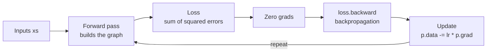

# micrograd from scratch

A tiny scalar-valued **autograd engine** and a small **neural network library** built on top of it, written from scratch in pure Python, following Andrej Karpathy's lecture [*The spelled-out intro to neural networks and backpropagation: building micrograd*](https://www.youtube.com/watch?v=VMj-3S1tku0).

Every number is wrapped in a `Value` object that records how it was computed. Calling `.backward()` on the final output runs **reverse-mode automatic differentiation (backpropagation)** over that computation graph and fills in the gradient of every node. On top of this engine sit `Neuron`, `Layer` and `MLP` classes, trained with **gradient descent**.


---

## Highlights

- **Autograd engine** (`Value`): `+`, `-`, `*`, `/`, `**`, unary `-`, `tanh`, `exp`, plus reflected ops so expressions like `2 * v` and `sum([...])` work
- **Backpropagation** via topological sort and reverse traversal, with gradient accumulation (`+=`) for nodes used more than once
- **Graph visualization** with Graphviz: every node shows its `data` and `grad`
- **Gradients checked:** backprop worked by hand on a small expression, identical results through two different decompositions of `tanh`, and a match against **PyTorch**
- **Neural net library:** `Neuron` → `Layer` → `MLP`, with a `parameters()` API like `torch.nn.Module`
- **Training loop:** forward pass → loss → zero grads → backward → update

---

## How it works



### 1. Derivatives as sensitivity

The notebook starts numerically: nudge an input by a small `h` and measure how much the output moves, `(f(x + h) - f(x)) / h`. For `f(x) = 3x² − 4x + 5` at `x = −3`, `h = 0.1` gives −21.7, close to the exact derivative −22 (the gap shrinks with `h`). For `d = a*b + c`, nudging `a` gives a slope of `b = -3`. This is exactly what backpropagation will later compute analytically.

### 2. The `Value` object

```python
a = Value(2.0, label='a')
b = Value(-3.0, label='b')
c = Value(10.0, label='c')
e = a * b
d = e + c
f = Value(-2.0, label='f')
L = d * f          # L = (a*b + c) * f = -8.0
```

Each `Value` stores its `data`, its `grad` (∂L/∂node), its parent nodes, the operation that produced it, and a `_backward` closure that applies the **chain rule** locally:

| Operation | Local derivative | Backward rule |
|---|---|---|
| `a + b` | 1, 1 | gradient passes through unchanged |
| `a * b` | b, a | each input gets the *other* input × upstream grad |
| `a ** k` | k·aᵏ⁻¹ | power rule |
| `tanh(a)` | 1 − tanh²(a) | scaled by 1 − out² |
| `exp(a)` | eᵃ | scaled by the output itself |

Subtraction and division are composed from these primitives (`a - b = a + (-b)`, `a / b = a * b**-1`), so they get correct gradients with no extra derivative code.

### 3. Backpropagation

```python
def backward(self):
    # 1. topological sort: every node after its inputs
    # 2. seed: dL/dL = 1
    # 3. walk the graph in reverse, calling each node's _backward()
```

Reverse topological order guarantees each node has received its **complete** gradient from all consumers before it passes gradient further back.

Before writing `backward()`, the notebook does backprop **by hand** on `L = (a*b + c) * f`, applying the local rules node by node from `L` back to the leaves:

| Node | a | b | c | e | d | f | L |
|---|---|---|---|---|---|---|---|
| **grad** | 6 | −4 | −2 | −2 | −2 | 4 | 1 |

### 4. A single neuron

`o = tanh(x1*w1 + x2*w2 + b)` with `x1 = 2`, `x2 = 0`, `w1 = -3`, `w2 = 1`, `b = 6.8813…` (chosen so that `o = 1/√2 ≈ 0.7071`).

The same gradients come out whether `tanh` is a single primitive or rebuilt as `(e - 1) / (e + 1)` with `e = exp(2n)`, which confirms the chain rule works over any decomposition of the same function.

### 5. Verification against PyTorch

| Parameter | micrograd | PyTorch |
|---|---|---|
| `x1` | −1.5 | −1.5000003852 |
| `w1` | 1.0 | 1.0000002568 |
| `x2` | 0.5 | 0.5000001284 |
| `w2` | 0.0 | 0.0 |

The tiny differences come from `torch.Tensor([...])` creating **float32** values before `.double()` converts them: the bias `6.8813…` isn't exactly representable in float32. micrograd uses Python's float64 throughout.

### 6. Neural network

```python
n = MLP(3, [4, 4, 1])   # 3 inputs → 4 → 4 → 1 output, tanh everywhere
```

| Layer | Neurons | Params per neuron | Total |
|---|---|---|---|
| 1 | 4 | 3 weights + 1 bias | 16 |
| 2 | 4 | 4 weights + 1 bias | 20 |
| 3 | 1 | 4 weights + 1 bias | 5 |
| | | **Total** | **41** |

### 7. Training

```python
for k in range(20):
    # forward pass
    ypred = [n(x) for x in xs]
    loss = sum((yout - ygt)**2 for ygt, yout in zip(ys, ypred))

    # backward pass
    for p in n.parameters():
        p.grad = 0.0
    loss.backward()

    # update (gradient descent)
    for p in n.parameters():
        p.data += -0.5 * p.grad
```

---

## Results

A binary classification toy problem: 4 samples, 3 features, targets ±1.

| Sample | Input | Target | Prediction |
|---|---|---|---|
| 1 | `[2.0, 3.0, -1.0]` | 1.0 | 0.99988 |
| 2 | `[3.0, -1.0, 0.5]` | −1.0 | −0.99996 |
| 3 | `[0.5, 1.0, 1.0]` | −1.0 | −0.99996 |
| 4 | `[1.0, 1.0, -1.0]` | 1.0 | 0.999996 |

Final loss after training: **≈ 1.5 × 10⁻⁸**. All four samples are classified correctly. Because `tanh` only reaches ±1 asymptotically, the loss approaches but never hits zero.

---

## Getting started

```bash
git clone https://github.com/jenishevd/micrograd.git
cd micrograd
pip install numpy matplotlib graphviz torch jupyter
jupyter notebook micrograd_from_scratch.ipynb
```

> **Note:** the `graphviz` Python package also needs the Graphviz system binary
> (`brew install graphviz` on macOS, `sudo apt install graphviz` on Ubuntu).
> PyTorch is only used for the gradient check.

---

## Project structure

```
.
├── micrograd_from_scratch.ipynb   # engine, visualization, neuron, MLP, training
├── README.md
└── .gitignore
```

---

## What I learned

- How **reverse-mode autodiff** works under the hood of PyTorch: computation graphs, local derivatives and the chain rule
- Why gradients must **accumulate** (`+=`) when a node is used more than once, and why they must be **zeroed** before every backward pass
- Why **topological order** matters for correct gradients
- How **numerical derivatives** (nudging an input by `h`) relate to the analytic gradients backprop computes
- How comparing against a reference framework (PyTorch) validates an implementation, down to float32 vs float64 effects
- Why `tanh` saturation near ±1 makes the loss shrink very slowly once predictions are close to the targets

---

## Limitations

- Scalar-only: one Python object per number, no vectorization or GPU, so it is suitable for learning, not for real workloads
- Recursive topological sort can hit Python's recursion limit on very large graphs
- No `__rsub__` / `__rtruediv__`, so `1 - v` and `2 / v` are unsupported (`v - 1` and `v / 2` work)

---

## Acknowledgements

Based on [micrograd](https://github.com/karpathy/micrograd) and the accompanying lecture by **Andrej Karpathy**. All code in this repository was written by me while following along.
